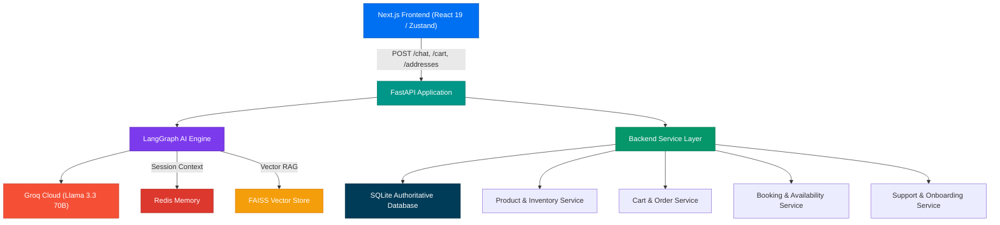
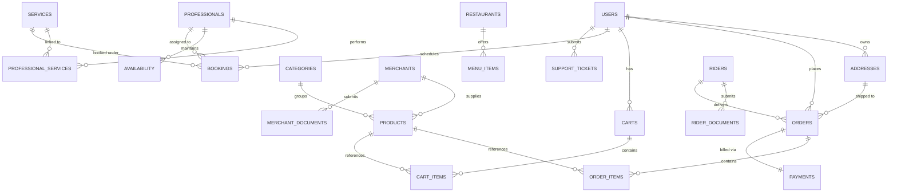

<p align="center">
  
</p>

<p align="center">
  
  
  
  
  
  
  
  
  
</p>

# BuyQK AI — Next-Gen Conversational Commerce Platform

> **Production-grade AI commerce and hyper-local service assistant** powered by **LangGraph multi-agent state orchestration**, **Groq/Llama-3.3-70B ultra-low latency inference**, a **FastAPI backend**, and a modern **Next.js frontend**.

BuyQK AI enables conversational commerce across **Grocery**, **Food Delivery**, **Medicine / Healthcare**, **Electronics**, **Home Services**, **Order Tracking**, **Cancellations & Refunds**, and **Customer Support**, alongside dedicated **Merchant & Rider Onboarding** workflows. The backend serves as the **authoritative single source of truth** for all transactions, pricing, stock, bookings, and policies—preventing hallucination and guaranteeing financial integrity.

---

## Table of Contents

- [What It Does](#what-it-does)
- [Key Features & Commerce Verticals](#key-features--commerce-verticals)
- [Tech Stack](#tech-stack)
- [System Architecture](#system-architecture)
- [LangGraph Orchestration Pipeline](#langgraph-orchestration-pipeline)
- [Project Structure](#project-structure)
- [Database Schema & Data Layer](#database-schema--data-layer)
- [Setup & Installation](#setup--installation)
- [Usage & API Endpoints](#usage--api-endpoints)
- [Testing](#testing)
- [Design Principles & Safety Rules](#design-principles--safety-rules)
- [Authors & Credits](#authors--credits)

---

## What It Does

| Capability | Description |
|---|---|
| **Grocery Shopping** | Search products by brand, price filters, quantity selection, and direct multi-item ordering |
| **Interactive Cart** | Add to cart, adjust quantities, view live subtotals, clear cart, and seamless cart checkout |
| **Food & Restaurants** | Browse nearby restaurants, filter by cuisine, explore menus, and order combo meals |
| **Medicine & Pharmacy** | Safe medicine lookup with prescription validation guardrails and strict medical advice filters |
| **Electronics Shopping** | Compare gadgets, filter by specifications (RAM, storage, color, brand, budget) |
| **Service Booking** | Book home services (Electricians, Plumbers, AC Repair, Carpenters) with live time slots |
| **Order Tracking** | Real-time order progress lookup, delivery ETA, context resolution (*"track my latest order"*) |
| **Cancellation & Refunds** | Automated cancellation eligibility check (verifies dispatch state) with refund tracking |
| **Customer Support** | Issue classification, automated ticket creation (SUP-XXXX), and human executive escalation |
| **Merchant & Rider Onboarding** | Complete registration, category assignment, document submission, and KYC verification API |
| **Multi-Intent Execution** | Sequential handling of multi-intent prompts (*"Order milk and track my last order"*) |
| **Multilingual Support** | Fluent conversational understanding across **English**, **Hindi**, and **Hinglish** |

---

## Key Features & Commerce Verticals

### 1. Grocery & Direct Ordering
- Sequential one-step-at-a-time checkout flow: `Product` &rarr; `Quantity` &rarr; `Address Selection` &rarr; `Payment Method (UPI / COD)` &rarr; `Order Confirmation & Bill`.
- Interactive UI selector cards inside the chat window for choosing saved addresses or entering a new address, and choosing payment methods.
- Real-time bill generation with subtotal, taxes, delivery fees, and final payable amount calculated authoritatively by the backend.

### 2. Full Cart Management
- First-class backend cart state (`/cart` API & `cart_service.py`).
- Dedicated frontend `/cart` page and synchronized in-chat cart drawer.
- Supports `add_item`, `remove_item`, `update_quantity`, `clear_cart`, `show_cart`, and `checkout_cart`.

### 3. Food Ordering & Restaurants
- Database models for `Restaurant` and `MenuItem` with cuisine indexing.
- Search restaurants by name, location, cuisine, or specific dishes.
- Interactive food menu cards in chat with vegetarian tags, pricing, and one-click ordering.

### 4. Medicine Ordering & Health Safety
- Safety knowledge base (`data/knowledge/medicine_safety.json`) enforcing non-medical advice rules.
- Tracks `prescription_required` flags on pharmaceutical inventory.
- Refuses to diagnose illnesses or recommend dosages, prompting users to upload valid prescriptions.

### 5. Electronics Comparison & Specs
- Deep specification extraction: RAM, internal storage, color, screen size, model number.
- Multi-product comparison engine (`data/knowledge/electronics_comparison.json`) comparing specs, warranties, and pricing side-by-side.

### 6. Home Service Booking
- Services supported: Electrician, Plumber, AC Repair, Home Cleaning, Carpenter, Painter, Appliance Repair.
- Availability slot engine (`availability_service.py`) checking professional rosters and time windows (Morning, Afternoon, Evening).
- Handles instant confirmation, technician assignment, and cancellation.

### 7. Merchant & Rider Onboarding Portals
- Full onboarding lifecycle via `/onboarding/merchants` and `/onboarding/riders`.
- Document submission endpoints for GSTIN, PAN, Driving Licenses, and Bank Account KYC.
- Verification and approval/rejection state machine.

---

## Tech Stack

### Frontend
- **Framework:** Next.js 16 (Turbopack, App Router) & React 19
- **Language:** TypeScript
- **State Management:** Zustand (for synchronized chat and cart stores)
- **Styling & Theme:** Deep Navy (`#0b162c`) & Vibrant Gold (`#f5b400`) design system with glassmorphism, backdrop filters, responsive layout, and interactive UI component cards.
- **Components:** `AddressSelector`, `PaymentSelector`, `Bill`, `Cart`, `CommerceResults`, `MessageBubble`, `ChatInput`, `SiteHeader`.

### Backend
- **API Framework:** FastAPI (Python 3.11+ / 3.12+)
- **ORM & Data Access:** SQLAlchemy 2.0 with connection pooling
- **Validation:** Pydantic v2 schemas
- **Storage:**
  - **SQLite:** Authoritative transactional database (Orders, Products, Carts, Bookings, Users, Support Tickets, Onboarding)
  - **Redis:** Fast ephemeral conversation and session context cache
  - **FAISS:** Vector similarity search for Knowledge Base Retrieval-Augmented Generation (RAG)

### AI & Orchestration
- **Workflow Engine:** LangGraph (StateGraph pipeline)
- **Framework:** LangChain Core & LangChain Community
- **Inference Provider:** Groq Cloud (ultra-fast tensor inference)
- **Models:** Llama 3.3 70B Versatile / Llama 3.1 8B Instant / Qwen 2.5
- **Structured Output:** Pydantic schema-guided structured LLM responses

---

## System Architecture



---

## LangGraph Orchestration Pipeline

Every user turn flows through a multi-node state graph ensuring zero hallucination, strict policy compliance, and deterministic execution:


| Node | Purpose | Responsibilities |
|---|---|---|
| **Intent Node** | Semantic Classification | Identifies primary intent (`order_create`, `cart`, `service_booking`, `order_tracking`, `order_cancel`, `customer_support`, `product_search`, `general`). |
| **Multi-Intent Node** | Queue Orchestration | Resolves multiple requests in one turn, prioritizes primary tasks, and queues secondary intents safely. |
| **Entity Node** | Structured Extraction | Extracts product names, brands, quantities, order IDs, addresses, time slots, and payment types. |
| **Planner Node** | Action Planning | Determines the exact required capability (`start_checkout`, `add_to_cart`, `create_booking`, etc.) and pinpoints missing fields. |
| **Policy Node** | Safety & Authorization | Verifies ownership, validates quantities, checks cancellation windows, and enforces domain rules. |
| **Decision Node** | Deterministic Routing | Routes the state machine either to execute a backend tool or return a conversational clarifying response. |
| **Tool Node** | Backend Execution | Calls authoritative Python services to read/write from SQLite. The LLM never touches the DB directly. |
| **Response Node** | Natural Language & UI Generation | Generates multilingual replies (English, Hindi, Hinglish) and emits structured UI metadata (AddressSelector, Bill, etc.). |

---

## Project Structure

```
buyqk-ai/
├── ai_engine/                         # AI & LangGraph State Machine
│   ├── graph/
│   │   ├── builder.py                 # Graph construction & edge wiring
│   │   ├── runner.py                  # run_chat() entry point
│   │   └── state.py                   # GraphState TypedDict definition
│   ├── nodes/
│   │   ├── intent_node.py             # Intent classification (LLM + structured output)
│   │   ├── multi_intent_node.py       # Sequential multi-intent queue manager
│   │   ├── entity_node.py             # Entity extraction & normalization
│   │   ├── planner_node.py            # Execution planner & argument resolution
│   │   ├── policy_node.py             # Business rule validation & security
│   │   ├── decision_node.py           # Deterministic routing logic
│   │   ├── tool_node.py               # Authoritative backend tool executor
│   │   └── response_node.py           # Natural-language generator & UI metadata builder
│   ├── tools/
│   │   ├── registry.py                # Central ToolRegistry
│   │   ├── contracts.py               # Tool contract definitions
│   │   ├── cart_tools.py              # Cart action bindings
│   │   └── product_tools.py           # Product catalog bindings
│   ├── prompts/
│   │   └── system_prompt.txt          # Core persona, guardrails & behavior contract
│   └── tests/                         # 45+ comprehensive AI engine e2e test suites
│
├── backend/                           # FastAPI Application & Business Logic
│   ├── api/
│   │   ├── chat.py                    # POST /chat (AI conversational endpoint)
│   │   ├── cart.py                    # REST endpoints for /cart operations
│   │   ├── addresses.py               # REST endpoints for saved addresses
│   │   ├── onboarding.py              # REST API for Merchant & Rider onboarding
│   │   └── health.py                  # GET /health system status
│   ├── database/
│   │   ├── sqlite.py                  # SQLite engine & sessionmaker
│   │   ├── base.py                    # SQLAlchemy DeclarativeBase
│   │   ├── dependencies.py            # DB session dependency injection
│   │   ├── redis_client.py            # Redis connection & cache client
│   │   └── vector_store.py            # FAISS vector database wrapper
│   ├── models/                        # SQLAlchemy ORM Models (19 database tables)
│   │   ├── user.py, address.py, product.py, category.py
│   │   ├── order.py, order_item.py, payment.py
│   │   ├── cart.py, cart_item.py
│   │   ├── restaurant.py, menu.py
│   │   ├── service.py, professional.py, availability.py, booking.py
│   │   ├── support_ticket.py
│   │   └── merchant.py, rider.py, merchant_document.py, rider_document.py
│   ├── schemas/                       # Pydantic validation schemas
│   ├── services/                      # Authoritative Business Services
│   │   ├── product_service.py         # Product search & inventory validation
│   │   ├── order_service.py           # Order creation, billing, cancellation
│   │   ├── cart_service.py            # Cart CRUD & total calculation
│   │   ├── service_service.py         # Home services catalog
│   │   ├── availability_service.py    # Time slot & professional scheduling
│   │   ├── booking_service.py         # Booking lifecycle management
│   │   ├── restaurant_service.py      # Food & restaurant search
│   │   ├── support_service.py         # Support ticket filing & escalation
│   │   └── onboarding_service.py      # Merchant & rider verification logic
│   └── main.py                        # FastAPI main application entry point
│
├── frontend/                          # Next.js 16 Web Application
│   ├── app/
│   │   ├── layout.tsx                 # Root layout & font injection
│   │   ├── globals.css                # Deep Navy & Gold design system & glassmorphism
│   │   ├── page.tsx                   # Modern landing page
│   │   ├── chat/page.tsx              # Main AI chat interface
│   │   ├── cart/page.tsx              # Dedicated cart dashboard
│   │   └── orders/page.tsx            # Order history & status viewer
│   ├── components/
│   │   ├── SiteHeader.tsx             # Translucent sticky header with brand logo
│   │   ├── chat/
│   │   │   ├── ChatWindow.tsx         # Conversation viewer & dynamic card renderer
│   │   │   ├── ChatInput.tsx          # Auto-growing chat input form
│   │   │   ├── MessageBubble.tsx      # User (Gold gradient) & AI chat bubbles
│   │   │   ├── AddressSelector.tsx    # Interactive address selection card
│   │   │   ├── PaymentSelector.tsx    # Interactive payment method picker
│   │   │   ├── Bill.tsx               # Structured order bill summary
│   │   │   └── CommerceResults.tsx    # Product & menu card grids
│   │   └── cart/
│   │       ├── Cart.tsx               # Chat drawer cart component
│   │       └── CartPage.tsx           # Full-page cart experience
│   ├── services/
│   │   ├── chat.ts                    # Backend API client for chat & addresses
│   │   └── cart_service.ts            # Cart REST API integration
│   └── store/
│       └── chatStore.ts               # Zustand store for chat state, history & cart
│
├── data/knowledge/                    # Structured Knowledge Bases (JSON)
│   ├── electronics_comparison.json    # Specifications & comparison matrices
│   ├── medicine_safety.json           # Pharmacological guardrails & safety rules
│   └── merchant_categories.json       # Onboarding category definitions
│
├── requirements.txt                   # Python dependencies
└── pytest.ini                         # Pytest configuration
```

---

## Database Schema & Data Layer



---

## Setup & Installation

### Prerequisites
- **Python 3.11+** or **3.12+**
- **Node.js 18+** & **npm** (or **pnpm**)
- **Groq API Key** &mdash; Get a free key at [console.groq.com](https://console.groq.com)
- **Redis** *(Optional &mdash; automatic in-memory fallback enabled if Redis is not running)*

### 1. Clone & Setup Backend

```bash
# Clone the repository
git clone https://github.com/Rohit1x52/BuyQK-Chatbot.git
cd BuyQK-Chatbot

# Create and activate Python virtual environment
python -m venv buyqkai
# Windows:
buyqkai\Scripts\activate
# macOS/Linux:
# source buyqkai/bin/activate

# Install Python dependencies
pip install -r requirements.txt
```

### 2. Configure Environment Variables

Create a `.env` file in the repository root:

```env
GROQ_API_KEY=gsk_your_groq_api_key_here
GROQ_MODEL=llama-3.3-70b-versatile
LLM_TEMPERATURE=0
LLM_MAX_TOKENS=1024

# Optional: Redis Configuration (Defaults to in-memory fallback if omitted)
REDIS_HOST=localhost
REDIS_PORT=6379
REDIS_DB=0
```

### 3. Initialize Database & Seed Data

```bash
# Initialize SQLite database tables
python -m backend.database.init_db

# Seed sample products (Grocery, Medicines, Electronics)
python backend/seed_products.py

# Seed service professionals (Electricians, Plumbers, AC Repair)
python backend/seed_services.py
```

### 4. Setup Frontend

```bash
cd frontend
npm install
```

Create `frontend/.env.local`:

```env
NEXT_PUBLIC_API_URL=http://127.0.0.1:8000
```

---

## Usage & API Endpoints

### Run the Application

**Terminal 1 (Backend API Server):**
```bash
# From repository root
uvicorn backend.main:app --host 127.0.0.1 --port 8000 --reload
```

**Terminal 2 (Next.js Frontend):**
```bash
# From frontend directory
cd frontend
npm run dev
```

Open your browser at:
- **Web App:** [http://localhost:3000](http://localhost:3000)
- **AI Chat Assistant:** [http://localhost:3000/chat](http://localhost:3000/chat)
- **Cart Page:** [http://localhost:3000/cart](http://localhost:3000/cart)
- **Swagger API Docs:** [http://127.0.0.1:8000/docs](http://127.0.0.1:8000/docs)
- **API Health Check:** [http://127.0.0.1:8000/health](http://127.0.0.1:8000/health)

### Key REST Endpoints

| Method | Endpoint | Description |
|---|---|---|
| `POST` | `/chat` | Main AI conversation orchestration endpoint |
| `GET` | `/cart` | Retrieve user cart with line items and subtotal |
| `POST` | `/cart/items` | Add product to cart |
| `PATCH` | `/cart/items/{id}` | Update quantity of a cart item |
| `DELETE` | `/cart/items/{id}` | Remove item from cart |
| `DELETE` | `/cart` | Empty user cart |
| `GET` | `/addresses` | Fetch saved delivery addresses |
| `POST` | `/addresses` | Save new delivery address |
| `POST` | `/onboarding/merchants` | Register merchant business profile |
| `POST` | `/onboarding/riders` | Register delivery rider profile |
| `POST` | `/onboarding/merchants/{id}/documents` | Upload merchant KYC verification documents |
| `GET` | `/health` | Application health and DB connection check |

---

## Testing

The project has an exhaustive automated test suite with **over 620+ passing tests** covering the AI engine, graph state transitions, cart pipeline, and service layers.

Run all tests from the repository root:

```bash
# Run the complete test suite
pytest ai_engine/tests/ -v

# Run specific functional test suites
pytest ai_engine/tests/test_cart_pipeline.py
pytest ai_engine/tests/test_booking_e2e.py
pytest ai_engine/tests/test_customer_support_e2e.py
pytest ai_engine/tests/test_multi_intent_e2e.py
pytest ai_engine/tests/test_order_tracking.py
pytest ai_engine/tests/test_order_cancellation.py
```

---

## Design Principles & Safety Rules

1. **Authoritative Backend Truth:** The AI engine is strictly an orchestration and semantic presentation layer. All calculations (totals, discounts, delivery fees, taxes, stock availability, and cancellation policies) are computed exclusively by Python service code against SQLite.
2. **Sequential Multi-Intent Handling:** If a user makes multiple requests in one message (*"Buy milk and track order 102"*), the primary request is processed first; the secondary intent is queued and executed only after the primary task completes.
3. **No Hallucinated Actions:** Orders, cancellations, and support tickets are never confirmed in chat until the tool node receives an authoritative success response from the backend.
4. **Strict Medical & Prescription Guardrails:** The AI is strictly barred from offering medical, diagnostic, or dosage advice. When prescription medicines are requested, the flow enforces prescription submission.
5. **Privacy & Security:** Sensitive database credentials, internal node names, system prompts, and raw stack traces are stripped before responses reach the user.

---

## Authors & Credits

- **Rohit Ranjan Kumar** &mdash; *Creator, Architecture & Lead Developer*  
  [GitHub (@Rohit1x52)](https://github.com/Rohit1x52)
- **Krishana Gopal** &mdash; *Conversation Flows & User Experience Design (Sprint 1)*

---

<p align="center">
  <sub>Built with ❤️ for <strong>BuyQK</strong> by <strong>Rohit Ranjan Kumar</strong></sub>
</p>
